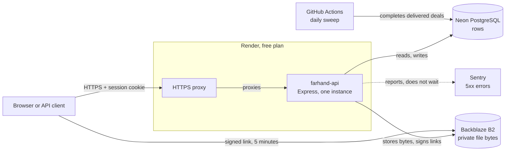
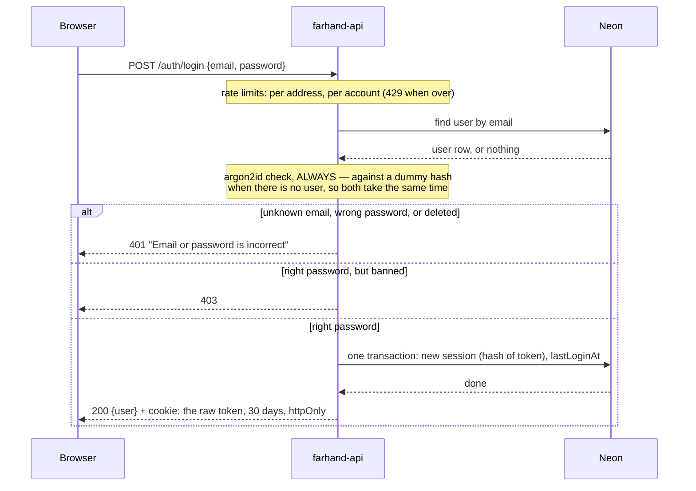
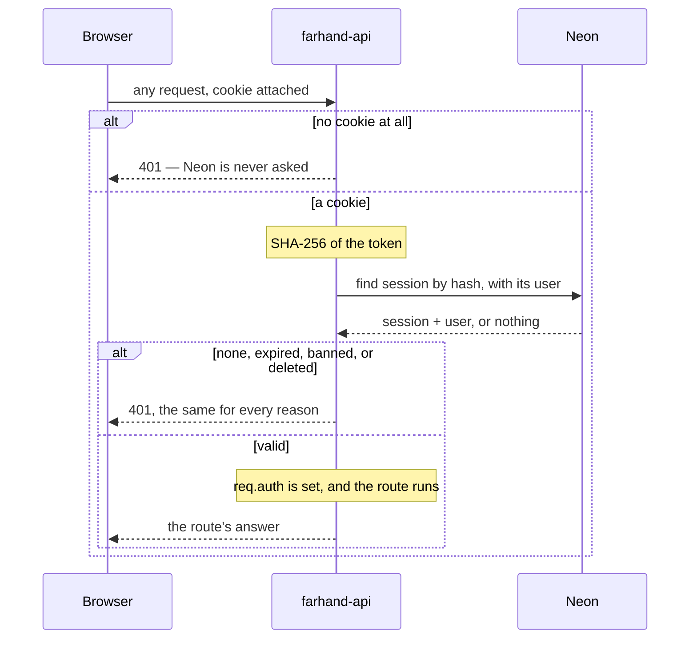
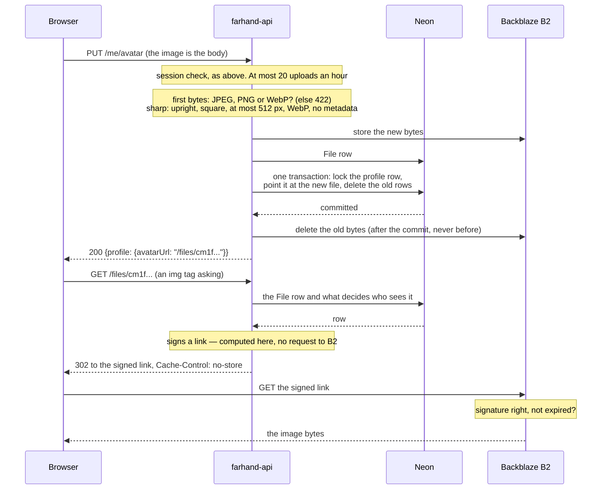

# Architecture

What runs where, what talks to what, and why. Drawn from the code, not from
memory: every box below exists, and nothing that does not exist is drawn
(#100). The gaps are a section of their own.

The diagrams are Mermaid, so GitHub shows them as pictures and they change in
the same commit as the system they describe (rule 3 in `README.md`). The
FigJam board they were sketched on is
[Farhand — the system as it is](https://www.figma.com/board/JUZi7DFV52lZPChkLCbjhC):
a place to think, not the record.

## The system

How to read it. **Solid arrows** are synchronous: whoever sends waits for the
answer. The **dotted arrow** is the one that does not wait. An arrow shows who
starts a conversation; the reply travels back the same way and is not drawn.
The order of things, and the replies, are what the sequence diagrams below are
for.

The arrow worth looking at twice is the last one: **the browser fetches file
bytes from B2 directly**, never through the API. The API only decides who may
see a file and hands out a link that works for five minutes (`#79`).

The second odd one is the sweep: **GitHub Actions reaches the database without
going through the API at all** (#101). It is the only writer that is not a
request, which is why it is drawn outside Render — it runs on somebody else's
machine, on a clock, and uses Neon's direct connection string rather than the
pooled one the API uses.

## Why each box exists

**Browser or API client.** Whoever starts a request. The API trusts it through
three things and no more: the session cookie (`httpOnly`, `sameSite: lax`), a
CORS rule that allows exactly one origin — `APP_ORIGIN`, never `*`, because a
wildcard and credentials together are forbidden and would let any page on the
internet act as whoever is signed in — and `sameOriginWrites`, which refuses a
write whose `Origin` or `Referer` is anything else.

"API client" is only half true, and worth knowing: `curl` and the tests read
freely, but a write with no `Origin` header is refused with `403` while
`CSRF_ENABLED` is on, which it is by default. These defences are aimed at
browsers. A script can set any header it likes, so what really protects a write
is the session check — the origin check protects a *user* from another website,
not the API from a script.

**HTTPS proxy (Render).** Terminates TLS, so the API itself never needs a
certificate and never speaks it. It passes the real client address in
`X-Forwarded-For`, and `trust proxy` set to `1` makes Express believe exactly
that one hop. Without it every request appears to come from the proxy: one
rate-limit bucket shared by the whole world — 20 login attempts per 15 minutes
for all of Farhand — and a "logged in from…" record that says nothing. With
`true` instead of `1`, a caller could forge an address per request and take an
unlimited budget, or forge somebody else's and lock them out.

**farhand-api.** One app, because a transaction is free and a saga is not:
`acceptProposal`'s five writes are all-or-nothing only because they share one
database. Splitting it would mean building compensating actions, idempotency
and an outbox by hand — and losing the constraints too, since no index can
span two databases. One *instance*, for two independent reasons: the free plan
allows no more, and the rate-limit counters live in this process's memory, so
a second would double every published limit (#91). Otherwise it is stateless —
nothing else in `src/` remembers anything between requests.

**Neon.** Data outlives the host. Because the database belongs to a different
vendor, #96 — moving the API from Fly to Render under a trial deadline — was a
configuration change rather than a data migration with a clock on it. Two
connection strings: the app uses the **pooled** one, which survives many
short-lived connections; migrations use the **direct** one, because the pooler
lends a connection per transaction and Prisma's migration lock is session-level.
A pooler is not a transparent pipe — anything that depends on staying on one
connection breaks behind it. Same region as the API, because latency is paid
per round trip and a transaction takes several.

**Backblaze B2.** Keeps file bytes out of the database — Neon's free tier is
0.5 GB — and off a 512 MB machine. The bucket is private: the API decides who
may see a file, then redirects to a signed link good for five minutes. Signing
is local arithmetic, so it costs no request to B2. The price is two round trips
per image on a cold page — reduced but not removed by #102, which gave the
endpoint its own rate limit, let the browser keep the redirect for a minute,
and cut the permission check from four database statements to two.

## Following a request

### Logging in

Once per device. `POST /auth/login`, in `src/routes/auth.ts`.

The order of the checks is the security property. The ban is checked **after**
the password: checked first, an email alone would reveal that an account
exists and is banned. Neon only ever holds a SHA-256 hash of the token, so a
copy of the database is not a copy of anybody's session (decision 0007).

### Using a session

Every request that needs one. `requireAuth`, in `src/middleware/auth.ts`.

Every reason for a `401` looks the same from outside. The browser learns
"sign in again" and nothing about why — not even whether the account still
exists.

### Uploading an avatar, then seeing it

`PUT /me/avatar` (`src/services/avatars.ts`), then `GET /files/:id`
(`src/services/files.ts`). Both are #80 and #79.

The API's part ends at the `302`. The bytes go from B2 to the browser without
passing through the API's 512 MB machine — the cost is one extra round trip
per image, paid on purpose (decision 0011).

It is paid **again on every view the browser actually makes** — and #102
reduced how many that is. The redirect may be cached for a minute, which is
less than the five-minute signature it carries, so a cached copy can never
point at a dead one: one avatar on twenty cards is one request rather than
twenty. Past that minute the browser asks again, and the answer costs two
database statements rather than the four it used to (#102 measured four; a
file is an avatar *or* a need photo *or* a receipt, so two of the three
relations it loaded were never going to be read).

What remains is one API request per image on a cold page. Removing that needs
the list response to carry its own signed links. #81 built the half that was
missing — `GET /needs` now gives each card a `coverPhoto` — and deliberately
made it a path rather than a link, so the request is still made. #93 is where
that trade gets decided, with decision 0012 as the argument against
(`docs/11-risks.md`).

## What is not there yet

| Missing | What happens today | Issue |
|---|---|---|
| A domain of its own | `APP_ORIGIN` is the API's own `onrender.com` address, and mail is sent from an address whose domain the provider rewrites, because a free mailbox cannot be DKIM-signed by us (#119, decision 0014). A domain fixes the sender, the link in a verification email, and the placeholder together — and it is half the fix for #121, where an unsubscribe click on a confirmation email locks somebody out for good, since the other half is a provider that only free tiers with a domain will give us (decision 0015) | #93 |
| Emails anybody asked for | Verification and password resets are delivered since #119. Nothing tells a person that their need was matched or their deal moved — that is which-events-email, a `Notification` table, and an opt-out | #86 |
| A verification LINK rather than a code | The email carries a code, because a link needs a page to land on and an inbox cannot follow a link to `POST /auth/verify-email` | #93 |
| Anything that notices the sweep stopping | A failing run emails; a schedule GitHub disables after 60 idle days does not. The symptom would be deals stuck at `DELIVERED` | #101 named it, #85 may do more |
| Anything asynchronous | Every arrow but Sentry's is somebody waiting. `forgot-password` has a known few-millisecond timing gap a queue would close | #85 |
| A second instance | Blocked twice over: the free plan, and the in-memory rate limits | #91 |
| Signed links inside list responses | A page of N images is N requests to the API. #102 made each one cheaper and took it out of the browsing budget. #81 added the list response that carries images — `GET /needs` gives each card a `coverPhoto` — but as a **path**, so the N requests are still there. Whether a list should hand out signed links instead is #93's to decide, and decision 0012 holds the argument against it: a signed link dies in five minutes and anything that stored the answer dies with it | #93 |
| A frontend | `APP_ORIGIN` is the API's own URL — a placeholder until something else deserves it | #93 |
| Proof the hop count is right | `trust proxy 1` assumes exactly one proxy, inherited from the Fly setup and never checked. Log in on production and compare `Session.ipAddress` with your real address; a CDN in front would make it two | — |
| A measured latency figure | The cross-Atlantic numbers in this document are estimates. `GET /health/ready` returns the real `latencyMs` from the deployed service | — |

### One of these has a trap in it: where the frontend lives

The session cookie is `sameSite: "lax"`, which means a browser will not attach
it to a `fetch` from a **different site**. That is not about the API's CORS
rule, which can be configured; it is the browser's own decision, and it is made
before CORS is consulted.

`onrender.com` and `vercel.app` are public suffixes, so every subdomain counts
as its own site. A frontend at `farhand-web.vercel.app` calling
`farhand-api.onrender.com` would therefore log in to a `200` and then appear
signed out on the very next request, with nothing in either log to explain it.
The exact mechanism varies — the browser may refuse to store the cookie or
refuse to send it, depending on the browser and its third-party cookie
settings — but the outcome is the same either way.

Three ways out, and #93 should pick one before it builds anything:

1. **One registrable domain for both** — `app.example.ee` and `api.example.ee`.
   Needs a domain, which is the only thing on this page that costs money.
2. **The frontend proxies the API under its own address** (Next.js rewrites),
   so the browser only ever sees one site. Costs an extra hop per request.
3. **`sameSite: "none"`**, which works and gives up what Lax was doing: a
   browser-level defence against another site making a request as you. The
   `Origin` check (#28) would be carrying it alone, and browsers are steadily
   restricting third-party cookies anyway.

Found while writing this map, which is what the map is for.

## Keeping this true

A change that adds, removes or rewires a box or an arrow changes this file in
the same commit. A diagram that has quietly stopped being true is worse than
none: people believe it.
