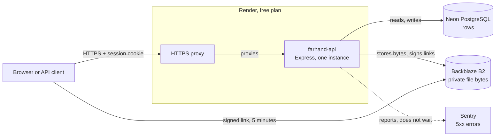
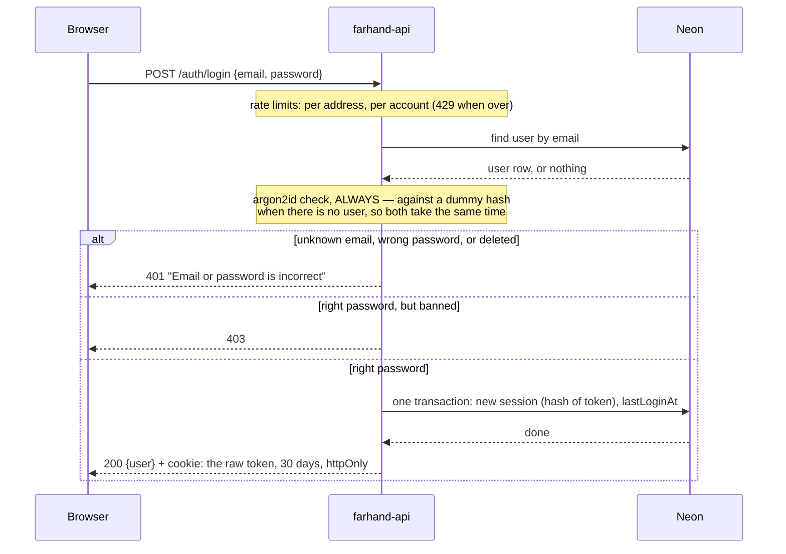
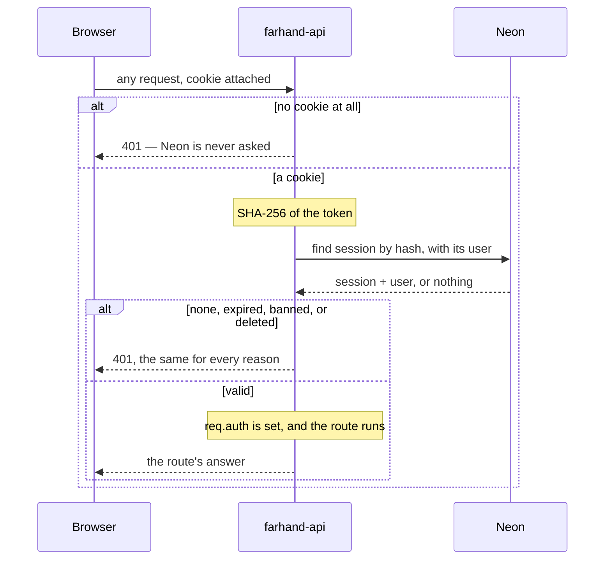
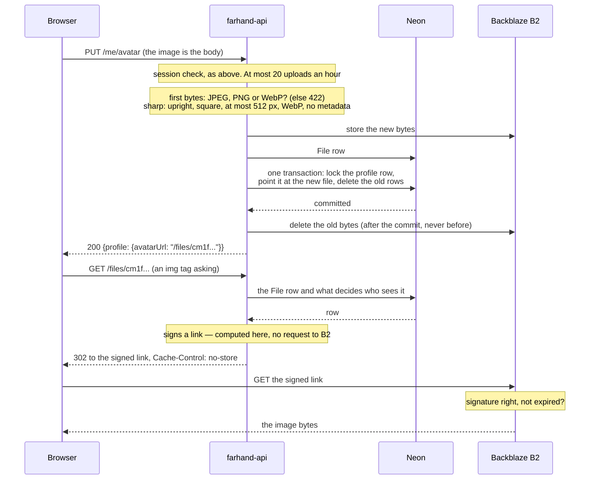

# Architecture

What runs where, what talks to what, and why. Drawn from the code, not from
memory: every box below exists, and nothing that does not exist is drawn
(#100). The gaps are a section of their own.

The diagrams are Mermaid, so GitHub shows them as pictures and they change in
the same commit as the system they describe (rule 3 in `README.md`). The
FigJam board they were sketched on is
[Farhand — the system as it is](https://www.figma.com/board/JUZi7DFV52lZPChkLCbjhC):
a place to think, not the record.

## The system

How to read it. **Solid arrows** are synchronous: whoever sends waits for the
answer. The **dotted arrow** is the one that does not wait. An arrow shows who
starts a conversation; the reply travels back the same way and is not drawn.
The order of things, and the replies, are what the sequence diagrams below are
for.

The arrow worth looking at twice is the last one: **the browser fetches file
bytes from B2 directly**, never through the API. The API only decides who may
see a file and hands out a link that works for five minutes (`#79`).

## Why each box exists

<!--
TODO(#100) — yours. One short paragraph per box: what it is FOR, what would go
wrong without it, and a link to where the decision is recorded. Your FigJam
stickies are most of this already. The questions, if a blank page helps:

- Browser or API client: who is on this side today, and who will be after #93?
- HTTPS proxy: what does it do that the API does not? (Hint: `trust proxy` in
  src/app.ts, and why that setting is 1 and not true.)
- farhand-api: why one app and not several services, and why exactly ONE
  instance? (docs/14-deployment.md, "One instance, deliberately"; #91)
- Neon: why the data is not on the same platform as the API — and what that
  bought us in #96. (docs/14-deployment.md; decisions 0002, 0010)
- Backblaze B2: why bytes are not in the database. (decision 0011)
- Sentry: why the API does not wait for it, and what is reported and what is
  not. (docs/09-environment.md, "SENTRY_DSN")
-->

## Following a request

### Logging in

Once per device. `POST /auth/login`, in `src/routes/auth.ts`.

The order of the checks is the security property. The ban is checked **after**
the password: checked first, an email alone would reveal that an account
exists and is banned. Neon only ever holds a SHA-256 hash of the token, so a
copy of the database is not a copy of anybody's session (decision 0007).

### Using a session

Every request that needs one. `requireAuth`, in `src/middleware/auth.ts`.

Every reason for a `401` looks the same from outside. The browser learns
"sign in again" and nothing about why — not even whether the account still
exists.

### Uploading an avatar, then seeing it

`PUT /me/avatar` (`src/services/avatars.ts`), then `GET /files/:id`
(`src/services/files.ts`). Both are #80 and #79.

The API's part ends at the `302`. The bytes go from B2 to the browser without
passing through the API's 512 MB machine — the cost is one extra round trip
per image, paid on purpose (decision 0011).

## What is not there yet

<!--
TODO(#100) — yours. Each gap in a line or two: what is missing, what happens
today because of it, and the issue that will fill it (or "no issue yet" — then
it needs one). The ones the map has found so far:

- Email: verification and reset links are not sent anywhere in production.
  (#85, #86)
- A scheduler: `npm run job:auto-complete` (#25) exists and is tested, and
  nothing runs it — a delivered deal nobody confirms stays DELIVERED for ever.
  (no issue yet)
- Anything asynchronous: every arrow except Sentry's is somebody waiting.
  (#85)
- A second instance: the rate-limit counters live in one process's memory.
  (#91)
- A cache or CDN in front of the files. (docs/14-deployment.md, "What is not
  here")
- The frontend. (#93)
-->

## Keeping this true

A change that adds, removes or rewires a box or an arrow changes this file in
the same commit. A diagram that has quietly stopped being true is worse than
none: people believe it.
